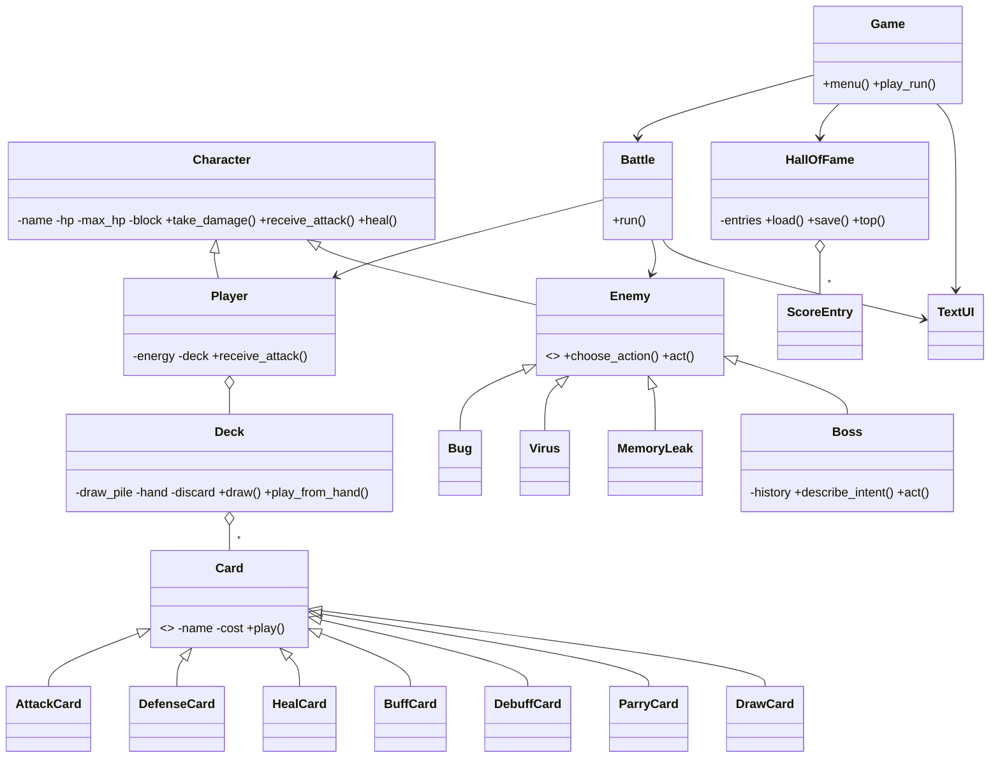

# BackEnd Dungeons

Jogo de cartas por turnos com construção de baralho, em **Python**, feito para o
projeto final de Programação com Objectos. És um programador dentro de um
computador infetado: as cartas são comandos e os inimigos são bugs, vírus e o
boss final (**O Rootkit**). Limpa **10 salas** para vencer.

## Instalar e executar
Não precisa de instalar nada (só a biblioteca standard do Python 3.9+).

```
python main.py          # jogar
python test_bot.py      # testes das regras + simulação de 300 runs com um bot
```

## Como jogar
Em cada turno compras **1 carta** (básica de ataque ou defesa, ou uma especial
aleatória) e jogas as cartas que quiseres. A **energia acumula** entre turnos
(+3 por turno, máximo 8), por isso podes poupar para jogadas fortes. Bloqueio e
parry desaparecem no início do teu turno. Depois de cada combate recuperas 10%
da vida e escolhes **1 carta entre 3**. O boss esconde as ações mas repete um
padrão de 3 turnos: observa o histórico!

## Estrutura do código
| Ficheiro | Conteúdo |
| --- | --- |
| `config.py` | Todas as constantes de equilíbrio (vida, energia, custos...) |
| `characters.py` | `Character` (base) e `Player` |
| `enemies.py` | `Enemy` (abstrata), `Bug`, `Virus`, `MemoryLeak`, `Boss`, `Intent` |
| `cards.py` | `Card` (abstrata) e subclasses de cartas |
| `deck.py` | `Deck` (baralho, mão, compra e descarte) |
| `battle.py` | `Battle`: o ciclo do turno |
| `hall_of_fame.py` | `HallOfFame` e `ScoreEntry`: recordes em `scores.json` |
| `ui.py` | `TextUI`: toda a interface em texto (separada da lógica) |
| `game.py` | `Game`: menu e ciclo da run |

## Requisitos da disciplina
- **R1**: mais de 4 classes próprias; atributos `_hp`, `_energy`, `_block`... só mudam por métodos.
- **R2**: `Card` com 6 subclasses que redefinem `play()`; `Enemy` com 4 subclasses que redefinem `choose_action()`; `Player` redefine `receive_attack()` (parry).
- **R3**: baralho, mão e descarte são listas de `Card`; recordes gravados e lidos em `scores.json`.
- **R4**: entradas inválidas são repetidas, energia insuficiente é recusada, ficheiro de recordes em falta ou corrompido não rebenta o jogo.

## Diagrama de classes


## Declaração de uso de IA
Código gerado com o Claude (Anthropic) a partir do relatório do jogo. Verificação:
testes automáticos (`test_bot.py`), simulação de runs com um bot e teste manual
na consola. **A equipa deve rever e perceber todas as classes antes da banca.**
