# BackEnd Dungeons

Jogo de cartas por turnos com construção de baralho, em **Python**, feito para o
projeto final de Programação com Objectos. És um programador dentro de um
computador infetado: as cartas são comandos, os inimigos são bugs, vírus e o
boss final (**O Rootkit**). Escolhe o modo **Normal (10 salas)** ou **Rápido (5 salas)**.

## Instalar e executar
Só precisa do Python 3.9+. A biblioteca `rich` é **opcional** (interface a cores):

```
pip install rich        # opcional (menus, mão, recompensas e recordes a cores)
python main.py          # jogar (usa cores se o rich estiver instalado)
python main.py --plain  # forçar o modo texto simples

python -m unittest discover -s tests -t .   # 125 testes automáticos
python simulate.py                          # simula 300 runs por bot e por modo
```

## Como jogar
- Em cada turno **compras 1 carta**: básica de ataque, básica de defesa ou uma carta do
  **teu baralho**. As cartas especiais (cura, buff, parry...) chegam ao baralho pelas
  recompensas de fim de combate, por isso o que escolhes durante a run importa.
- A **energia acumula** entre turnos (+3 por turno, máximo 8): podes poupar para jogadas fortes.
- Bloqueio e parry desaparecem no início do teu turno. A mão tem no máximo 8 cartas.
- Depois de cada combate recuperas 10% da vida e escolhes **1 carta entre 3**, ou fazes
  **REFACTOR**: melhoras uma carta que já tens (ex.: `Segfault` passa a `Segfault+`, só uma vez).
- Há 17 cartas (cada uma com versão melhorada): ataques, defesa, cura, parry, buffs, debuffs
  (incluindo **veneno**, que ignora o bloqueio) e cartas de **RISCO** (`Sudo`, `Infinite Loop`).
- Em certas salas (3, 6 e 9 no modo normal; 2 e 4 no rápido) escolhes **1 relíquia entre 2**.
  As relíquias alteram as regras até ao fim da run (ex.: +1 energia por turno). Há 10, e duas
  são de **RISCO** (`Overvolt`, `Código Legado`): muito poder, com um preço.
- O boss esconde as ações mas repete um padrão de 3 turnos; o ecrã mostra o histórico.
- Depois do turno 12 os inimigos enfurecem-se (+1 de dano por turno), por isso
  nenhum combate se arrasta para sempre.
- A run é **gravada depois de cada combate**: podes sair e escolher "Continuar a run
  guardada" no menu (só existe uma run guardada de cada vez).

## Modos de jogo
| Modo | Salas | Boss | Relíquias depois das salas |
| --- | --- | --- | --- |
| Normal | 10 | 75 de vida | 3, 6 e 9 |
| Rápido | 5 | 55 de vida | 2 e 4 |

A dificuldade depende do **progresso** (sala atual / total), não do número da sala:
a última sala de qualquer modo tem sempre a dificuldade "de sala 10". Os recordes
têm uma tabela para cada modo.

## Equilíbrio (validado por simulação)
`simulate.py` corre runs reais com a classe `Game`, só trocando a interface por um bot.
Resultados com 500 runs por linha:

| Bot | Normal | Rápido |
| --- | --- | --- |
| NaiveBot (joga a carta mais cara; limite inferior) | 0% de vitórias | 4% |
| SmartBot (defende, usa parry, debuffs, escolhe bem; aproxima um jogador razoável) | 45% | 53% |

O boss é o grande obstáculo (é onde morre a maioria das runs perdidas do SmartBot).
Todos os valores de equilíbrio estão em `config.py`, `modes.py` e no topo de `enemies.py`.

## Estrutura do código
| Ficheiro | Conteúdo |
| --- | --- |
| `config.py` | Constantes de equilíbrio (vida, energia, anti-impasse...) |
| `modes.py` | `GameMode` e os modos Normal e Rápido |
| `characters.py` | `Character` (base) e `Player` |
| `enemies.py` | `Enemy` (abstrata), `Bug`, `Virus`, `RaceCondition`, `MemoryLeak`, `Trojan`, `Boss`; `Intent` (abstrata) com `AttackIntent`, `DefendIntent`, `WeakenIntent`, `ExposeIntent`, `HealIntent` |
| `cards.py` | `Card` (abstrata), 10 subclasses de cartas e o catálogo (orientado a dados) com as versões melhoradas |
| `relics.py` | `Relic` e 10 relíquias (Overclock, Antivirus, Cache L1, Stack Trace, Backup, Macro, Linter, Auto-Save, Overvolt, Código Legado) |
| `deck.py` | `Deck` (baralho, mão, compra e descarte) |
| `battle.py` | `Battle`: o ciclo do turno |
| `hall_of_fame.py` | `HallOfFame` e `ScoreEntry`: recordes em `scores.json` |
| `fileutil.py` | `write_text_atomic`: escrita segura (ficheiro temporário + `os.replace`) usada pelos recordes e pela gravação |
| `names.py` | `is_acceptable_name`: filtro de nomes impróprios para os recordes |
| `savegame.py` | `SaveGame` e `RunState`: run gravada em `save.json` |
| `ui.py` / `ui_rich.py` | `RunUI` e `GameUI` (abstratas: o contrato), `TextUI` (texto) e `RichUI` (cores, tabelas e painéis): toda a interface, separada da lógica |
| `game.py` | `Game`: menu e ciclo da run |
| `simulate.py` | Bots para validar o equilíbrio |
| `tests/` | 125 testes `unittest` (um por regra) |
| `PLAYTEST.md` | Folha para a equipa registar o playtest humano |
| `GUIA_BANCA.md` | Guia de preparação para a banca (perguntas prováveis por módulo) |

## Requisitos da disciplina
- **R1**: mais de 4 classes próprias; atributos `_hp`, `_energy`, `_block`... só mudam por métodos (propriedades só de leitura cá fora).
- **R2**: `Card` (abstrata) com 10 subclasses que redefinem `play()` (algumas herdam de outras: `PiercingAttackCard` e `RecoilAttackCard` herdam de `AttackCard`); `Enemy` (abstrata) com 6 subclasses que redefinem `choose_action()`; `Intent` (abstrata) com 5 subclasses que redefinem `describe()` e `execute()`; `Relic` com 10 subclasses que redefinem ganchos; `Player` redefine `receive_attack()` e `outgoing_damage()`; `RunUI` (abstrata) é implementada pela `TextUI`, pelo `RichUI` e pelos bots; `GameUI` acrescenta os menus; `RichUI` herda de `TextUI` e redefine só os métodos `_show_*` (template method).
- **R3**: baralho, mão e descarte são listas de `Card`; recordes em `scores.json` e run gravada em `save.json`, ambos lidos e escritos.
- **R4**: entradas inválidas são repetidas; energia insuficiente é recusada; ficheiros de recordes ou de gravação em falta, corrompidos ou adulterados não rebentam o jogo; os ficheiros são escritos de forma atómica (um corte a meio não os estraga); nomes impróprios são recusados (e ignorados se vierem de um ficheiro editado); começar uma run nova com uma gravação existente pede confirmação; README, diagrama e 125 testes.

## Diagrama de classes

```mermaid
classDiagram
    class Character { -name -hp -max_hp -block -vulnerable -weak +take_damage() +receive_attack() +heal() +outgoing_damage() }
    class Player { -energy -deck -relics -parry +start_combat() +start_turn() +notify_card_played() +receive_attack() +outgoing_damage() }
    class Enemy { <<abstract>> -level -intent +choose_action() +plan() +act() +describe_intent() }
    class Bug
    class Virus
    class RaceCondition
    class MemoryLeak
    class Trojan
    class Boss { -history +describe_intent() +act() }
    class Intent { <<abstract>> -value -hits +describe() +execute() }
    class AttackIntent
    class DefendIntent
    class WeakenIntent
    class ExposeIntent
    class HealIntent
    class Card { <<abstract>> -name -cost +play() }
    class AttackCard
    class PiercingAttackCard
    class RecoilAttackCard
    class EnergyCard
    class DefenseCard
    class HealCard
    class BuffCard
    class DebuffCard
    class ParryCard
    class DrawCard
    class Relic { -name +on_combat_start() +on_turn_start() +on_card_played() +attack_bonus() +heal_after_combat() }
    class Overclock
    class Antivirus
    class CacheL1
    class StackTrace
    class Backup
    class Macro
    class Linter
    class AutoSave
    class Overvolt
    class LegacyCode
    class Deck { -draw_pile -hand -discard +draw() +play_from_hand() }
    class GameMode { key rooms boss_hp relic_rooms +difficulty_room() }
    class Battle { +run() }
    class Game { +menu() +play_new() +continue_run() }
    class HallOfFame { -entries +load() +save() +top() }
    class ScoreEntry
    class SaveGame { +save() +load() +delete() }
    class RunUI { <<abstract>> +ask_name() +message() +show_state() +choose_card() +choose_reward() }
    class GameUI { <<abstract>> +main_menu() +show_help() +show_hall() }
    class NaiveBot
    class TextUI
    class RichUI
    Character <|-- Player
    Character <|-- Enemy
    Enemy <|-- Bug
    Enemy <|-- Virus
    Enemy <|-- RaceCondition
    Enemy <|-- MemoryLeak
    Enemy <|-- Trojan
    Enemy <|-- Boss
    Card <|-- AttackCard
    AttackCard <|-- PiercingAttackCard
    AttackCard <|-- RecoilAttackCard
    Card <|-- EnergyCard
    Card <|-- DefenseCard
    Card <|-- HealCard
    Card <|-- BuffCard
    Card <|-- DebuffCard
    Card <|-- ParryCard
    Card <|-- DrawCard
    Relic <|-- Overclock
    Relic <|-- Antivirus
    Relic <|-- CacheL1
    Relic <|-- StackTrace
    Relic <|-- Backup
    Relic <|-- Macro
    Relic <|-- Linter
    Relic <|-- AutoSave
    Relic <|-- Overvolt
    Relic <|-- LegacyCode
    RunUI <|-- GameUI
    GameUI <|-- TextUI
    TextUI <|-- RichUI
    RunUI <|-- NaiveBot
    Player o-- Deck
    Player o-- "*" Relic
    Deck o-- "*" Card
    Intent <|-- AttackIntent
    Intent <|-- DefendIntent
    Intent <|-- WeakenIntent
    Intent <|-- ExposeIntent
    Intent <|-- HealIntent
    Enemy --> Intent
    Enemy --> GameMode
    Game --> Battle
    Game --> HallOfFame
    Game --> SaveGame
    Game --> GameUI
    HallOfFame o-- "*" ScoreEntry
    Battle --> Player
    Battle --> Enemy
    Battle --> RunUI
```


## Declaração de uso de IA
Código gerado com o Claude (Anthropic) a partir do relatório do jogo e da retrospetiva
da equipa. Verificação: 125 testes automáticos, simulação de milhares de runs com bots
(que apanhou um impasse real e levou ao mecanismo de "enfurecer"), e testes manuais na
consola. **A equipa deve rever e perceber todas as classes antes da banca.**
