# BackEnd Dungeons

Jogo de cartas por turnos com construção de baralho, em **Python**, feito para o
projeto final de Programação com Objectos. És um programador dentro de um
computador infetado: as cartas são comandos, os inimigos são bugs, vírus e o
boss final (**O Rootkit**). Escolhe o modo **Normal (10 salas)** ou **Rápido (5 salas)**.

## Instalar e executar
Só precisa do Python 3.9+. A biblioteca `rich` é **opcional** (interface a cores):

```
pip install rich        # opcional (menus, mão, recompensas e recordes a cores)
python main.py          # jogar (usa cores se o rich estiver instalado)
python main.py --plain  # forçar o modo texto simples

python -m unittest discover -s tests -t .   # testes automáticos
python simulate.py                          # simula 300 runs por bot e por modo
```

## Como jogar
- Em cada turno **compras 1 carta**: básica de ataque, básica de defesa ou uma carta do
  **teu baralho**. As cartas especiais (cura, buff, parry...) chegam ao baralho pelas
  recompensas de fim de combate, por isso o que escolhes durante a run importa.
- A **energia acumula** entre turnos (+3 por turno, máximo 8): podes poupar para jogadas fortes.
- Bloqueio e parry desaparecem no início do teu turno. A mão tem no máximo 8 cartas.
- Depois de cada combate recuperas 10% da vida e escolhes **1 carta entre 3**, ou fazes
  **REFACTOR**: melhoras uma carta que já tens (ex.: `Segfault` passa a `Segfault+`, só uma vez),
  ou uma **MUTAÇÃO**: uma carta ganha um efeito novo, sempre com um preço (ver abaixo).
- Há 17 cartas (cada uma com versão melhorada): ataques, defesa, cura, parry, buffs, debuffs
  (incluindo **veneno**, que ignora o bloqueio) e cartas de **RISCO** (`Sudo`, `Infinite Loop`).
- Em certas salas (3, 6 e 9 no modo normal; 2 e 4 no rápido) escolhes **1 relíquia entre 2**.
  As relíquias alteram as regras até ao fim da run (ex.: +1 energia por turno). Há 15, e três
  são de **RISCO** (`Overvolt`, `Modo Seguro`, `Código Legado`): muito poder, com um preço.
- Há 9 inimigos normais, que vão aparecendo à medida que se avança: além dos clássicos, o
  **Worm** (3 golpes), o **Adware** (enche o teu descarte de `Spam`), o **Keylogger** (veneno
  que o bloqueio não trava) e o **Ransomware** (rouba a energia que guardaste).
- O boss esconde as ações mas repete um padrão de 3 turnos; o ecrã mostra o histórico.
- Depois do turno 12 os inimigos enfurecem-se (+1 de dano por turno), por isso
  nenhum combate se arrasta para sempre.
- A run é **gravada a cada resposta tua**: podes sair a qualquer momento, mesmo a meio de um
  combate, e escolher "Continuar a run guardada" no menu: retomas no mesmo ponto, com as
  mesmas cartas na mão e o mesmo inimigo (só existe uma run guardada de cada vez). Sair não
  serve para repetir um combate: ver "Gravação à prova de batota".

## Modos de jogo
| Modo | Salas | Boss | Relíquias depois das salas |
| --- | --- | --- | --- |
| Normal | 10 | 75 de vida | 3, 6 e 9 |
| Rápido | 5 | 55 de vida | 2 e 4 |

A dificuldade depende do **progresso** (sala atual / total), não do número da sala:
a última sala de qualquer modo tem sempre a dificuldade "de sala 10". Os recordes
têm uma tabela para cada modo.

## Mutações
Em vez de uma carta nova, a recompensa pode ser uma **mutação**: sorteia-se uma por recompensa
(voltar atrás no menu não a muda) e escolhes a carta que a recebe. Cada carta só pode ter uma
e ela mantém-se quando fazes REFACTOR. O custo nunca desce abaixo de 1.

| Mutação | Efeito |
| --- | --- |
| Instável | custo -1, mas perdes 2 de vida ao jogá-la |
| Recursivo | custo +1, mas o efeito acontece duas vezes |
| Vampírico | recuperas 2 de vida ao jogá-la |
| Blindado | ganhas 3 de bloqueio ao jogá-la |
| Infectado | o inimigo fica Envenenado 2 turnos |
| Efémero | custo -1, mas é exilada até ao fim do combate depois de jogada |
| Compilado | custo +1, mas compras 1 carta do baralho ao jogá-la |

Uma carta mutada continua a ser um `AttackCard`, um `DefenseCard`... (a mutação é um objeto
pendurado na carta, não uma subclasse), e grava-se como `Segfault|Vampírico`.

## Gravação à prova de batota
Se só se gravasse entre salas, sair a meio de um combate difícil e continuar repunha o
estado anterior (*save scumming*). Aqui cada sala corre com uma **semente** e o jogo grava,
resposta a resposta, tudo o que o jogador decide nessa sala (`replay.py`). Ao continuar,
a sala volta a correr com a mesma semente e as respostas gravadas são repetidas em
silêncio; quando acabam, o jogador está exatamente onde estava. O sorteio das cartas, dos
inimigos, das recompensas e das relíquias usa um gerador próprio do jogo (`rng.py`), por
isso o que os bots ou a interface fazem com o `random` nunca o altera. O teste
`test_quitting_anywhere_changes_nothing` sai em 9 pontos diferentes de uma run e confirma que
o resultado final é igual ao de uma run sem interrupção.

## Equilíbrio (validado por simulação)
`simulate.py` corre runs reais com a classe `Game`, só trocando a interface por um bot.
Resultados com 500 runs por linha:

| Bot | Normal | Rápido |
| --- | --- | --- |
| NaiveBot (joga a carta mais cara; limite inferior) | 1% de vitórias | 9% |
| SmartBot (defende, usa parry, debuffs, escolhe bem; aproxima um jogador razoável) | 41% | 58% |

O boss é o grande obstáculo (é onde morre a maioria das runs perdidas do SmartBot).
Todos os valores de equilíbrio estão em `config.py`, `modes.py` e no topo de `enemies.py`.

## Estrutura do código
| Ficheiro | Conteúdo |
| --- | --- |
| `config.py` | Constantes de equilíbrio (vida, energia, anti-impasse...) |
| `modes.py` | `GameMode` e os modos Normal e Rápido |
| `characters.py` | `Character` (base) e `Player` |
| `enemies.py` | `Enemy` (abstrata), `Bug`, `Virus`, `RaceCondition`, `MemoryLeak`, `Trojan`, `Worm`, `Adware`, `Keylogger`, `Ransomware`, `Boss`; `Intent` (abstrata) com 8 subclasses (`AttackIntent`, `DefendIntent`, `WeakenIntent`, `ExposeIntent`, `HealIntent`, `PoisonIntent`, `DrainIntent`, `SpamIntent`) |
| `cards.py` | `Card` (abstrata, com `play()` em template method), 11 subclasses de cartas (incluindo `JunkCard`) e o catálogo (orientado a dados) com as versões melhoradas |
| `mutations.py` | `Mutation` (base) e 7 mutações (Instável, Recursivo, Vampírico, Blindado, Infectado, Efémero, Compilado) |
| `relics.py` | `Relic` e 15 relíquias (Overclock, Antivirus, Cache L1, Stack Trace, Backup, Macro, Linter, Auto-Save, Defrag, Watchdog, Honeypot, Stack Canary, Overvolt, Modo Seguro, Código Legado) |
| `deck.py` | `Deck` (baralho, mão, compra e descarte) |
| `battle.py` | `Battle`: o ciclo do turno |
| `hall_of_fame.py` | `HallOfFame` e `ScoreEntry`: recordes em `scores.json` |
| `fileutil.py` | `write_text_atomic`: escrita segura (ficheiro temporário + `os.replace`) usada pelos recordes e pela gravação |
| `names.py` | `is_acceptable_name`: filtro de nomes impróprios para os recordes |
| `replay.py` | `RoomRecorder` (decorator de `RunUI`): grava e repete as respostas de uma sala; `ReplayError` |
| `rng.py` | Gerador aleatório do jogo (separado do `random` das interfaces e dos bots) |
| `savegame.py` | `SaveGame` e `RunState`: início da sala, semente e respostas gravadas em `save.json` |
| `ui.py` / `ui_rich.py` | `RunUI` e `GameUI` (abstratas: o contrato), `TextUI` (texto) e `RichUI` (cores, tabelas e painéis): toda a interface, separada da lógica |
| `game.py` | `Game`: menu e ciclo da run |
| `simulate.py` | Bots para validar o equilíbrio |
| `tests/` | Testes automáticos `unittest` (um por regra) |

## Requisitos da disciplina
- **R1**: mais de 4 classes próprias; atributos `_hp`, `_energy`, `_block`... só mudam por métodos (propriedades só de leitura cá fora).
- **R2**: `Card` (abstrata) com 11 subclasses que redefinem `_effect()` (o `play()` é um template method que aplica depois os ganchos da mutação; algumas herdam de outras: `PiercingAttackCard` e `RecoilAttackCard` herdam de `AttackCard`); `Enemy` (abstrata) com 10 subclasses que redefinem `choose_action()`; `Intent` (abstrata) com 8 subclasses que redefinem `describe()` e `execute()`; `Relic` com 15 subclasses e `Mutation` com 7, que redefinem ganchos; `Player` redefine `receive_attack()` e `outgoing_damage()`; `RunUI` (abstrata) é implementada pela `TextUI`, pelo `RichUI`, pelos bots e pelo `RoomRecorder` (decorator); `GameUI` acrescenta os menus; `RichUI` herda de `TextUI` e redefine só os métodos `_show_*` (template method).
- **R3**: baralho, mão e descarte são listas de `Card`; recordes em `scores.json` e run gravada em `save.json` (início da sala, semente e respostas), ambos lidos e escritos.
- **R4**: entradas inválidas são repetidas; energia insuficiente é recusada; ficheiros de recordes ou de gravação em falta, corrompidos ou adulterados não rebentam o jogo; os ficheiros são escritos de forma atómica (um corte a meio não os estraga); nomes impróprios são recusados (e ignorados se vierem de um ficheiro editado); começar uma run nova com uma gravação existente pede confirmação; README, diagrama e testes automáticos.

## Diagrama de classes

```mermaid
classDiagram
    class Character { -name -hp -max_hp -block -vulnerable -weak +take_damage() +receive_attack() +heal() +outgoing_damage() }
    class Player { -energy -deck -relics -parry +start_combat() +start_turn() +notify_card_played() +receive_attack() +outgoing_damage() }
    class Enemy { <<abstract>> -level -intent +choose_action() +plan() +act() +describe_intent() }
    class Bug
    class Virus
    class RaceCondition
    class MemoryLeak
    class Trojan
    class Worm
    class Adware
    class Keylogger
    class Ransomware
    class Boss { -history +describe_intent() +act() }
    class Mutation { <<abstract>> +modify_cost() +after_play() }
    class Unstable
    class Recursive
    class Vampiric
    class Armored
    class Infected
    class Ephemeral
    class Precompiled
    class JunkCard
    class Intent { <<abstract>> -value -hits +describe() +execute() }
    class AttackIntent
    class DefendIntent
    class WeakenIntent
    class ExposeIntent
    class HealIntent
    class PoisonIntent
    class DrainIntent
    class SpamIntent
    class Card { <<abstract>> -name -cost +play() }
    class AttackCard
    class PiercingAttackCard
    class RecoilAttackCard
    class EnergyCard
    class DefenseCard
    class HealCard
    class BuffCard
    class DebuffCard
    class ParryCard
    class DrawCard
    class Relic { -name +on_combat_start() +on_turn_start() +on_card_played() +on_damage_taken() +attack_bonus() +heal_after_combat() }
    class Overclock
    class Antivirus
    class CacheL1
    class StackTrace
    class Backup
    class Macro
    class Linter
    class AutoSave
    class Defrag
    class Watchdog
    class Honeypot
    class StackCanary
    class Overvolt
    class SafeMode
    class LegacyCode
    class Deck { -draw_pile -hand -discard +draw() +play_from_hand() }
    class GameMode { key rooms boss_hp relic_rooms +difficulty_room() }
    class Battle { +run() }
    class Game { +menu() +play_new() +continue_run() }
    class HallOfFame { -entries +load() +save() +top() }
    class ScoreEntry
    class SaveGame { +save() +update_log() +load() +delete() }
    class RoomRecorder { -log +choose_card() +choose_reward() }
    class RunUI { <<abstract>> +ask_name() +message() +show_state() +choose_card() +choose_reward() }
    class GameUI { <<abstract>> +main_menu() +show_help() +show_hall() }
    class NaiveBot
    class TextUI
    class RichUI
    Character <|-- Player
    Character <|-- Enemy
    Enemy <|-- Bug
    Enemy <|-- Virus
    Enemy <|-- RaceCondition
    Enemy <|-- MemoryLeak
    Enemy <|-- Trojan
    Enemy <|-- Worm
    Enemy <|-- Adware
    Enemy <|-- Keylogger
    Enemy <|-- Ransomware
    Enemy <|-- Boss
    Mutation <|-- Unstable
    Mutation <|-- Recursive
    Mutation <|-- Vampiric
    Mutation <|-- Armored
    Mutation <|-- Infected
    Mutation <|-- Ephemeral
    Mutation <|-- Precompiled
    Card o-- Mutation
    Card <|-- JunkCard
    Card <|-- AttackCard
    AttackCard <|-- PiercingAttackCard
    AttackCard <|-- RecoilAttackCard
    Card <|-- EnergyCard
    Card <|-- DefenseCard
    Card <|-- HealCard
    Card <|-- BuffCard
    Card <|-- DebuffCard
    Card <|-- ParryCard
    Card <|-- DrawCard
    Relic <|-- Overclock
    Relic <|-- Antivirus
    Relic <|-- CacheL1
    Relic <|-- StackTrace
    Relic <|-- Backup
    Relic <|-- Macro
    Relic <|-- Linter
    Relic <|-- AutoSave
    Relic <|-- Defrag
    Relic <|-- Watchdog
    Relic <|-- Honeypot
    Relic <|-- StackCanary
    Relic <|-- Overvolt
    Relic <|-- SafeMode
    Relic <|-- LegacyCode
    RunUI <|-- GameUI
    GameUI <|-- TextUI
    TextUI <|-- RichUI
    RunUI <|-- NaiveBot
    RunUI <|-- RoomRecorder
    RoomRecorder o-- RunUI
    Game --> RoomRecorder
    Player o-- Deck
    Player o-- "*" Relic
    Deck o-- "*" Card
    Intent <|-- AttackIntent
    Intent <|-- DefendIntent
    Intent <|-- WeakenIntent
    Intent <|-- ExposeIntent
    Intent <|-- HealIntent
    Intent <|-- PoisonIntent
    Intent <|-- DrainIntent
    Intent <|-- SpamIntent
    Enemy --> Intent
    Enemy --> GameMode
    Game --> Battle
    Game --> HallOfFame
    Game --> SaveGame
    Game --> GameUI
    HallOfFame o-- "*" ScoreEntry
    Battle --> Player
    Battle --> Enemy
    Battle --> RunUI
```


## Declaração de uso de IA
Código gerado com o Claude (Anthropic) a partir do relatório do jogo e da retrospetiva
da equipa. Verificação: testes automáticos, simulação de milhares de runs com bots
(que apanhou um impasse real e levou ao mecanismo de "enfurecer"), e testes manuais na
consola. **A equipa deve rever e perceber todas as classes antes da banca.**
